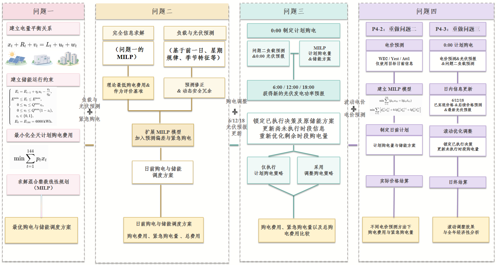

# 基于混合整数线性规划的动态购电与储能调度模型

研究2026年全国大学生数学建模竞赛C题“微网与外部电网电力调控策略”，联合优化微网购电与储能调度。项目包含论文、P1—P4模型、对照策略及结果复现程序。

[论文](paper/main.pdf) · [模型说明](docs/model-scope.md) · [数据与结果](docs/provenance.md) · [验证结果](docs/validation.md)

在2025年2月1日至12月31日的334天统计期内：

- 固定电价下，Dynamic相较固定70 kWh冗余策略，紧急购电量减少约79.7%，总费用减少约639.1万元。
- 波动电价下，冻结储能的滚动调整策略（WD2+bfreeze）相较不调整方案，紧急购电量减少60.75%，总费用降至约1617.26万元。



## 快速复现

安装[Git](https://git-scm.com/downloads/)、[PowerShell 7](https://learn.microsoft.com/zh-cn/powershell/scripting/install/install-powershell-on-windows)和[uv](https://docs.astral.sh/uv/getting-started/installation/)。重绘中文图表需要系统中文字体，支持微软雅黑、黑体或Noto Sans CJK SC。

在Windows的PowerShell 7中获取项目并进入根目录：

```powershell
git clone https://github.com/seraphic663/enmcm26.git
cd enmcm26
```

运行完整复现：

```powershell
uv run --isolated --no-project --python 3.12.14 --with-requirements requirements.txt `
  python code/run.py result.rebuild `
  --output-dir ("output/run-" + (Get-Date -Format yyyyMMdd-HHmmss))
```

uv自动准备Python 3.12.14和`requirements.txt`中的固定依赖，并缓存下载的包。程序完成全年求解、工作簿导出、表图生成及自动校验，成功时退出码为0。完整运行约需20—30分钟，具体取决于计算环境。

| 生成内容 | 位置 |
|---|---|
| 五个结果工作簿与逐日、逐时段证据 | `result/` |
| 十九张表、六张图 | `table/`、`figure/` |
| 结果校验、表格校验 | `verification.json`、`table-verification.json` |
| 运行日志、阶段耗时 | `run.log`、`steps.json` |

以上位置均相对于本次运行目录`output/run-时间戳/`。回放覆盖2025年365天，正式统计区间为2025-02-01至2025-12-31，共334天。

在复现命令末尾加`--dry-run`可预览求解与导出阶段；加`--smoke-days 32`可检查前32天的求解流程，保留各阶段的局部结果。短程模式跳过全年完美信息A、五份工作簿的统一汇总、表图生成和最终校验。

## 模型

| 部分 | 内容 |
|---|---|
| P1 | 典型日购电与储能联合调度，核对A/B时间映射 |
| P2 | 全年完美信息A、Yesterday、Yesterday+70、Dynamic |
| P3 | 无调整基准与6/12/18点光伏预报驱动的滚动调整 |
| P4 | 固定电价（Att1）、前一日电价（Yest）及同星期历史日均值（WD2）预测，比较不同调整策略 |

P4的调整策略包括不调整（A）、按前一日电价滚动调整（B0）、同步调整储能（bstar）和冻结储能滚动调整（bfreeze）；主策略为WD2+bfreeze。

P1采用CBC求解并以HiGHS独立校验；其余MILP采用SciPy HiGHS。物理约束、时间索引和费用口径见[模型说明](docs/model-scope.md)。

## 论文编译

使用XeLaTeX及ctex、tex-gyre、fandol等TeX包，可通过TeX Live或MiKTeX安装。正文采用Fandol中文字体与TeX Gyre Termes/Heros西文字体，由TeX发行版提供。

在项目根目录执行：

```powershell
New-Item -ItemType Directory -Force output/paper | Out-Null
$paperOut = (Resolve-Path output/paper).Path
Push-Location paper
try {
    1..3 | ForEach-Object {
        xelatex --interaction=nonstopmode --halt-on-error "--output-directory=$paperOut" main.tex
        if ($LASTEXITCODE -ne 0) { throw "论文编译失败" }
    }
} finally { Pop-Location }
```

编译结果为`output/paper/main.pdf`。

## 项目结构

| 目录 | 内容 |
|---|---|
| `paper/` | 论文源码、排版模板与PDF |
| `code/` | 模型、公共物理与结算实现、表图生成和校验 |
| `data/` | 赛题、输入附件与结果模板 |
| `result/`、`table/`、`figure/` | 论文结果的固定比对基准 |
| `docs/` | 模型、数据与验证说明 |

## 许可证

自有程序与项目说明采用[MIT](LICENSE)；论文模板采用[LPPL-1.3c](licenses/LPPL-1.3c.txt)。字体、研究材料和赛题附件的授权范围见[第三方声明](THIRD_PARTY_NOTICES.md)。
